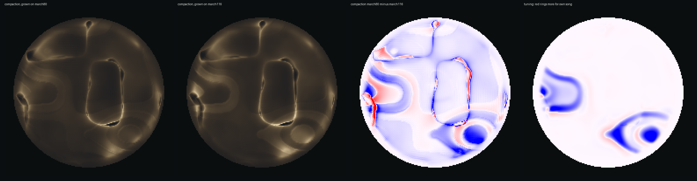

# World as Resonator

**Question:** if a song grows a world in Astra's [World](https://github.com/anttiluode/World), does that world become a resonator for that song? Does it ring more for the song that made it than for other songs?

**Answer: no.** It rings very slightly *less* for its own song, a weak habituation, and it cannot tell which song grew it. The habituation lives mostly in **compaction** and partly in resting sand, in a few local hollows. Mobile sand plays no part, because World's force pass never reads it.



*Left to right: compaction after growing on the 80 BPM march; compaction after the 116 BPM march; their difference; and the tuning map, where red = cells ringing more for their own song and blue = less. The song-specific response is confined to two hollows, both blue, both where compaction differs.*

*Do not hype. Do not lie. Just show.*

## What was run

World is used **unmodified**. `vendor/World_index.html` is a byte copy of World's `index.html` at commit `ceb9095` (sha256 `2643121…cd72cf`). The simulation shaders are read from that file and run headless through OpenGL/EGL, following the pattern of World's own `tests/gpu_egl.py`. This is a Mesa llvmpipe CPU backend, **not a browser and not your RTX 3060**.

1. **Songs.** `songs.cjs` synthesizes six 120-second drum-machine tracks as real audio. They come in pairs that differ in one thing only:
   - tempo: `march80` vs `march116`
   - register: `low96` (kick, bass, toms) vs `high96` (hats, lead, bells)
   - rhythm: `straight100` vs `broken100`

   World's own two generated weathers are added as a fourth pair. All audio is turned into band scores by World's own `features()` and its Korva-style `Organ`, loaded from World's code, not re-implemented.
2. **Grow.** One world per song, same seed, same starting ground: 120 s of song = 3840 ticks of World's 32 Hz clock.
3. **Listen.** Every grown world, plus the ungrown one, hears every song for 40 s **with the ground frozen** (World's own freeze mode), so listening writes nothing. The response is the mean oscillator energy |z|² over the basin, ignoring the first 8 s.
4. **Score.** `L = log(response / ungrown response)`, double-centred to remove "this world is louder overall" and "this song is louder overall". If worlds are tuned, the diagonal (world × its own song) is positive. A label-permutation null gives the p-value.

Five seeds: 2718, 1, 42, 2026, 7. Each 8×8 run takes about 5 minutes on llvmpipe.

## Results

| | Value |
|---|---|
| Own-song response, pooled over 5 seeds | **−0.67 %** (two-sided p = 0.017) |
| Recognition: which world rings most for a song | 0–1 of 8 per seed (chance = 1 of 8) |
| General dulling: grown vs ungrown, all songs | worlds respond 4–8 % less to everything |
| Spread between worlds for the same song | about 2–4 % (log) |

Per pair, 2×2 log gap `log(A:a · B:b / (A:b · B:a))` (positive = tuned, negative = habituated):

| Pair | Seeds 2718, 1, 42, 2026, 7 | Mean | Same sign |
|---|---|---|---|
| tempo 80 vs 116 | −0.035 −0.066 −0.047 −0.028 −0.038 | −0.043 | 5/5 negative |
| rhythm straight vs broken | −0.014 −0.032 −0.012 −0.001 −0.006 | −0.013 | 5/5 negative |
| register low vs high | +0.040 +0.028 −0.059 +0.038 −0.058 | −0.002 | mixed (3/5) |
| World weather 0 vs 1 | −0.003 +0.003 −0.013 −0.003 −0.002 | −0.004 | 4/5 negative |

What this says:

- The ground **does** remember tempo and rhythm in a reproducible way: those signs hold on every seed.
- The memory is the **wrong shape for a resonator**. Growing makes a world duller to everything, and the song-specific part is about ten times smaller than that dulling. Where it's specific, it's *less* response to the familiar song.
- Register has no consistent sign. On seeds 42 and 7 the low song barely drives the field at all (energy ~8×10⁻⁵ vs ~9×10⁻³ for the high song), because few cells on those seeds are mapped to low bands.

**Correction made during the run:** the first version of the pair index normalized raw energies by their sum. That let the loud high song swamp the quiet low one, and it wrongly reported register as "5/5 positive". It is now a log gap that weighs both songs equally. The pooled diagonal and recognition numbers always used logs and did not change.

## Mechanism: which channel holds it

`mechanism.py`: grow world A on song a and B on song b. Then copy ONE material channel from B into A and see how much of the gap that single swap moves. Doing the swap the other way (A's channel into B) gives the same shares to within 0.10.

| Pair, seed | Gap | Resting sand | Mobile sand | Compaction |
|---|---|---|---|---|
| tempo, 2718 | −0.036 | 25 % | 0 % | 75 % |
| tempo, 1 | −0.066 | 58 % | 0 % | 49 % |
| tempo, 42 | −0.047 | 34 % | 0 % | 70 % |
| register, 2718 | +0.040 | 150 % | 0 % | −60 % |
| register, 1 | +0.028 | 194 % | 0 % | −96 % |
| register, 42 | −0.059 | 6 % | 0 % | 95 % |

- **Tempo habituation is mostly compaction**, about half to three quarters, with resting sand carrying the rest. Compaction adds damping in World's force pass (`mu = -.32 - .8*m.b - …`), so the cells a song compacts go quieter.
- **In register, sand and compaction pull against each other.** Sand pushes toward tuning, compaction toward habituation, and the seed decides which wins. That's why register has no consistent sign.
- **Mobile sand: exactly 0 % everywhere.** World's force pass reads only resting sand (`m.r`, through height and frequency) and compaction (`m.b`), never mobile sand (`m.g`).

Raw data: `results/tuning.json` (all matrices), `results/pooled.json`, `results/tuning.log`.

## Why World can't become a resonator as built

In World's force pass, a song reaches a cell as a slow push, `drive = bands[b] + .34*echo[b]`. The band `b` is fixed by the **seeded** natural-frequency map `g.b`, not by the ground. The ground acts on the oscillator in only two places: resting sand raises the rotation rate (`+1.7*m.r`), and compaction adds damping (`-.8*m.b`). Neither lets a song choose *which* cells listen to *which* band, so the ground can only make cells louder or quieter. The mechanism test confirms it: the memory is a gain map, carried mostly by damping, not a tuned filter.

For World to become a resonator, at least one of these would have to change. They are listed as reasons, **not tested here**:

1. **Ground chooses the band.** Let material shift `g.b` (or the band lookup), so a cell's listening band can drift toward what drives it.
2. **Ringing in phase writes the opposite way.** Make cells that ring in step with the drive *loosen and deepen* (less damping), while cells out of step compact. In the current rules, stress mostly loosens and settling compacts, which gives habituation.
3. **Bigger frequency reach.** Measured on seed 2718 after 120 s of the 116 BPM march: resting sand peaks at 0.31 per cell (99th percentile 0.27), which shifts the rotation rate by at most 0.52. The seeded rates span 3.25 to 8.85, so the ground can move a cell's tuning by under a tenth of that range.

## Rerun

```sh
pip install numpy moderngl Pillow   # needs an EGL implementation
node songs.cjs                      # songs -> results/scores.json via World's own front end
python tuning.py 2718 1 42 2026 7   # 8x8 grow/listen matrices
python pooled.py                    # pooled two-sided analysis
python mechanism.py march80 march116 2718 1 42
python mechanism.py low96 high96 2718 1 42
python figure.py march80 march116 2718
```

`WRITE_WAV=1 node songs.cjs` also writes the test songs as .wav files, so you can play them into World in the browser yourself.

## Ledger

| Item | Status |
|---|---|
| World code | Unmodified; vendored byte copy, hash recorded |
| Front end and organ | World's own `features()` and `Organ`, executed from its file |
| Backend | Mesa llvmpipe through EGL. Not WebGL, not RTX 3060. Float results may differ across GPUs. |
| Songs | Synthetic drum-machine audio, not real music. Real songs might behave differently. |
| Response measure | Mean oscillator energy only. A spatial-pattern readout was not tested and might carry more song identity. |
| Grow length | 120 s per song. Longer growth was not tested. |
| Mechanism | 3 seeds × 2 pairs. Channel shares are single-swap estimates and need not sum to exactly 100 % (the channels interact). |
| Reproducibility | Tuning run and mechanism run reproduce identical gaps (e.g. −0.0594, register, seed 42) |
| Not done | Any modified World (the three changes above); real recorded songs; browser/RTX run |
